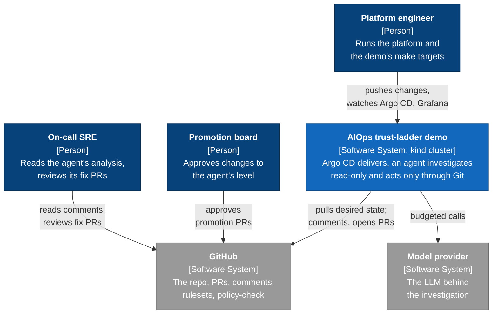
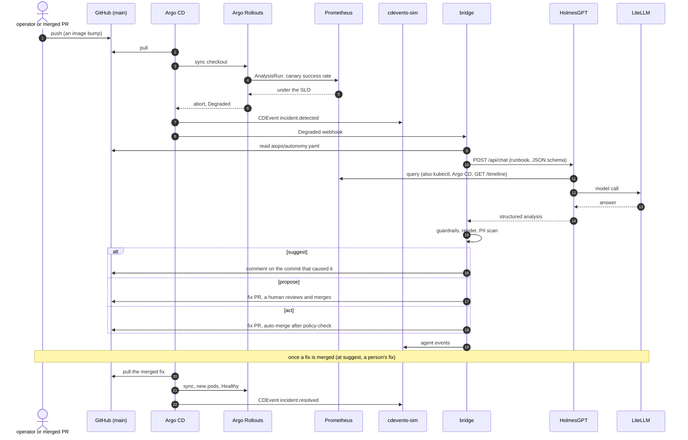

# Observability Is a Platform Problem Now: Closing the AIOps Loop with ArgoCD and GitOps

A demo of an AIOps agent that earns the right to act. An Argo CD rollout fails, the platform
records it as CDEvents, an agent investigates read-only, and the result goes back into Git as a
comment, a pull request, or a pull request that merges itself. What the agent may do is itself a
file in Git, and raising it is a reviewed pull request.

## What This Demonstrates

One incident, replayed at three levels of trust (the **trust ladder**):

| Rung | Level | What the agent does | Who acts |
|------|-------|---------------------|----------|
| 1 | `suggest` | Posts its root-cause analysis as a comment on the cause commit (or on the PR that merged it). | A human fixes it. |
| 2 | `propose` | Opens a two-line fix PR with the analysis and evidence in the body. | A human reviews and merges. |
| 3 | `act` | Opens the same PR and turns on auto-merge. It merges only after `policy-check` passes, which GitHub enforces as a required status. | A human reviews afterwards. |

The incident is the same each time. A change lowers a timeout (`UPSTREAM_TIMEOUT_MS`, 2000 to
200) without bumping the pod template's config-version annotation. The next image deploy starts
canary pods that read the new value, the canary fails its success-rate gate, and Argo CD reports
the `checkout` application Degraded. Argo CD Notifications then send the agent a webhook.

The loop being closed:

1. Argo CD and Notifications emit CDEvents (deployed, degraded, resolved) to a timeline.
2. The bridge receives the Degraded webhook, reads the agent's level from Git, and asks
   HolmesGPT for a structured root-cause analysis. HolmesGPT can read the cluster, Argo CD,
   Prometheus and the timeline. It cannot write anything.
3. The bridge checks the answer against guardrails, scans it for personal data and secrets, and
   writes the result to GitHub: a comment, a PR, or a PR with auto-merge.
4. Argo CD syncs the merge, the canary passes, the application is Healthy, and the incident
   resolves on the timeline.

Pages in [docs/](docs/00-index.md) cover each part.

## Demo Flow

The talk runs as one script, scene by scene, with no resets in between: each scene starts where
the one before it ended.

| Scene | What happens | Key concept |
|-------|-------------|-------------|
| **Cold open** (`demo-cold-open`) | 5 p.m.: the mandate to use AI, and an agent bolted onto the platform. 2:15 a.m.: the page. "What changed?" | Starting state: autonomy `suggest` |
| **Prologue** (`demo-prologue`) | Argo CD all green; the Grafana timeline with delivery events beside the error rate; the app's owner, tier and SLO labels | Delivery events as CDEvents, a shared language |
| **Scene 1** (`demo-scene-1`) | An innocent image bump; the canary aborts on a Prometheus gate; the agent comments on the older commit that caused it; a human fixes it | Rung 1, `suggest`: look, don't touch |
| **Scene 2** (`demo-scene-2`) | A promotion PR raises the level and the promotion board approves it; the incident again; the agent opens a two-line fix PR; a human reviews and merges | Rung 2, `propose`: autonomy as config, promoted by PR |
| **Scene 3** (`demo-scene-3`) | The `act` promotion; `make night` runs the nightly job; the agent's PR passes `policy-check` and merges with no human; the after-the-fact review | Rung 3, `act`: auto-merge only inside guardrails |
| **Epilogue** (`demo-epilogue`) | Human touch-points per rung on the dashboard; what is real and what is stood in; `make demote` back to `suggest` | Trust goes down as easily as it goes up |
| **Close** (`demo-close`) | Back to the timeline, where the signal now lives | |

### Running the Demo

```bash
make build-all                 # from scratch only: the kind cluster and the whole stack (~5 min)
scripts/stage-day.sh morning   # reset to the start state, preflight, budget check
make demo-cold-open            # then demo-prologue, demo-scene-1 ... demo-close

# Or run the full talk end to end
make demo-full
```

`DEMO_PACE=talk` (the default) stops for Enter only at a scene break, a fourth-wall break or a
speaker's beat, so the presenters talk while the script waits on the cluster. `DEMO_PACE=auto`
never stops and runs each scene's assertions; with `DEMO_AUTOMERGE_FOR_TEST=1` it also merges the
PRs a person would. Measured on a kind cluster with the real model, `DEMO_PACE=auto make
demo-full` takes about 9 minutes of machine time: scene 1 about 105 s, scene 2 about 180 s,
scene 3 about 240 s.

### If a Scene Stops

A scene that hits a failure branch (the agent hands off, no fix PR, `policy-check` left for
review, or scene 3 finding the level below `propose`) stops `demo-full`, which prints what to type
next. Play that rung's recording while you do it, and the later scenes still run live:

| Stopped in | While the clip plays | Then |
|------------|----------------------|------|
| Scene 1 | `make reset-to-scene-2` (about 70 s) | `make demo-scene-2` |
| Scene 2 | `make reset-to-scene-3` | `make demo-scene-3` |
| Scene 3 | | `make demo-epilogue && make demo-close` |
| Epilogue | | `make demo-close` |

Don't start the next scene without its reset: after a stop in scene 1, checkout is still armed
and Degraded, so scene 2's `make rearm` would refuse. After a stop in scene 3, the epilogue
demotes back to `suggest`, so autonomy is not left at `act`. If scene 2 stopped after an on-stage
reject (autonomy back at `suggest`), `make reset-to-scene-3` opens the `propose` promotion and
exits 6; go to the epilogue instead.

### Jumping to a Specific Scene

```bash
make reset-to-scene-0   # the start of the talk (same as make reset-demo)
make reset-to-scene-1   # rung 1: disarmed, suggest, history seeded
make reset-to-scene-2   # rung 2: suggest, a fresh propose promotion PR open
make reset-to-scene-3   # rung 3: propose, a fresh act promotion PR open (from suggest it
                        # opens the propose promotion PR and exits 6 instead)
```

### Recordings

`make record-scene-1|2|3` and `make record-full` record a scene or the whole talk to
`recordings/` at the stage terminal size; `make gif` converts a cast. The recorded scenes are the
backup if a live run stalls.

Running each rung by hand, the rung scripts, resets and stage day are in
[docs/06-operations.md](docs/06-operations.md).

## Architecture

The system context ([C4](https://c4model.com/) level 1): who uses the demo and what it depends
on. The containers inside the cluster (level 2) are in
[docs/01-architecture.md](docs/01-architecture.md#containers), and the bridge's components
(level 3) in [docs/04-bridge-and-holmes.md](docs/04-bridge-and-holmes.md#components).



### One incident, end to end

The autonomy level in `aiops/autonomy.yaml` decides what the bridge does at the end (the
`alt` block). Every other step is the same at every rung.



Namespaces: `argocd`, `argo-rollouts`, `monitoring`, `demo` (checkout, pricing, loadgen),
`aiops` (bridge, cdevents-sim, HolmesGPT, LiteLLM and its Postgres). HolmesGPT reads the
cluster (kubectl), Argo CD, Prometheus and the timeline (`GET /timeline`), and writes nothing;
the bridge is the only component with a Git-write credential. See
[docs/01-architecture.md](docs/01-architecture.md).

## Prerequisites

Tools. Versions marked pinned are checked by `make vendor` against [versions.env](versions.env).

| Tool | Version | Notes |
|------|---------|-------|
| Docker | Recent | Builds the demo images |
| [kind](https://kind.sigs.k8s.io/) | v0.33.0 | Pinned |
| kubectl | v1.37.2 | Pinned |
| kubectl-argo-rollouts plugin | v1.10.0 | Pinned |
| argocd CLI | v3.5.6 | Pinned |
| conftest | v0.71.1 | Pinned |
| gitleaks | v8.30.1 | Pinned |
| bats | 1.14.0 | Pinned |
| shellcheck | Recent | `make lint` |
| Helm | 3.x | Not pinned |
| gh | Recent | Operator login; scopes in [docs/github-setup.md](docs/github-setup.md) |
| jq, yq, envsubst, flock, curl, git, uv, pv | Recent | |
| asciinema, agg | v3.2.1, v1.9.0 | Pinned; recording only |
| systemd (user units) | Any | Only for the rung-3 scheduled job (`make night`) |

**Secrets.** Copy [.env.example](.env.example) to `.env`, mode 0600. It is never committed. The
keys, all blank in the example:

| Key | Used for |
|-----|----------|
| `ANTHROPIC_API_KEY`, `OPENAI_API_KEY` | LiteLLM's upstream provider keys (the second is optional) |
| `LITELLM_MASTER_KEY`, `LITELLM_SALT_KEY`, `LITELLM_DB_PASSWORD` | LiteLLM proxy and its Postgres |
| `LLM_BUDGET_USD` | Per-cluster LLM budget in LiteLLM. Also set a spend limit at the provider |
| `GRAFANA_ADMIN_PASSWORD` | Grafana admin login |
| `ARGOCD_ADMIN_PASSWORD` | Optional Argo CD admin login for a local demo; unset keeps Argo CD's generated one |
| `BRIDGE_WEBHOOK_TOKEN` | Bearer token Argo CD Notifications send to the bridge |
| `HOLMES_API_KEY` | `X-API-Key` HolmesGPT requires from the bridge |
| `GITHUB_APP_ID`, `GITHUB_INSTALLATION_ID`, `GITHUB_APP_KEY_PATH` | The bridge's GitHub App (key file must live outside the repo) |
| `STAGE_APPROVER_LOGIN` | Login that approves promotion PRs on stage |
| `EVIDENCE_DIR`, `PRECOMMIT_HOOK_SRC`, `TOOLS_BIN` | Optional local paths |

**GitHub.** The bridge writes to Git only as a GitHub App, and rulesets box that App in. Create
the App, install it on one repository (your fork), and apply the rulesets as described in
[docs/github-setup.md](docs/github-setup.md).

## Run it from your own fork

As published, the Applications read `argo-multiverse-labs/argoconna26`, and the operator
scripts push to it. Without push rights there, point the demo at a fork of yours:

1. Fork the repository on GitHub and clone your fork.
2. Set the three names and rewrite everything that uses them, then commit to your fork:

   ```bash
   make configure-fork REPO_SLUG=you/argoconna26 BOT_LOGIN=your-app[bot] PROMOTION_TEAM=@you/promotion-board
   make consistency          # prints "consistency: OK" when every name agrees
   git add -A && git commit -m "feat: configure the demo for my fork" && git push
   ```

   This changes `demo.env`, each Application's `repoURL` under `gitops/`, `.github/CODEOWNERS`,
   `policy/data/agent.yaml` and the two env values in `bridge/deploy/deployment.yaml`. Any name
   you leave out keeps its value, and running it twice changes nothing the second time.
   `BOT_LOGIN` is your GitHub App's login (`<app-name>[bot]`).
3. Copy [.env.example](.env.example) to `.env` (mode 0600) and add an LLM key.
4. `make operator-clone`. It pushes with your own `gh` login, or with a fine-grained token for
   your fork in `GH_TOKEN`.
5. `make build-all` (it creates the kind cluster), then `scripts/stage-day.sh morning` (the start
   state and the checks), then `make demo-full`. With rung 1 only, `make reset-demo` then
   `make demo-rung-1`.

What each rung needs on top of the platform:

| Rung | Needs |
|------|-------|
| The platform, the incident and `make naive-revert` | Push rights to your fork |
| 1 (suggest) | Also your own GitHub App with the permissions in [docs/github-setup.md](docs/github-setup.md), installed on the fork |
| 2 and 3 (propose, act) | Also a promotion-board team that owns the code-owner paths, the rulesets (`scripts/github-ruleset.sh apply`), `allow_auto_merge` on the repository, and Actions enabled (the `policy-check` workflow). Until those exist, run preflight with `PREFLIGHT_L5B=auto` |

`make retarget BRANCH=<branch>` moves the branch Argo CD, the bridge and the rulesets follow (for
example from `build/demo` to `main`, which is how the demo came to track `main`). It refuses a
destination the live rulesets do not already protect. See [docs/06-operations.md](docs/06-operations.md).

The fork path was checked on the upstream repository and by the tests in
`tests/bats/configure_fork.bats` and `tests/bats/consistency.bats`, not from a real fork.

## Quick Start

Argo CD pulls from GitHub, so the cluster follows what is pushed to the tracked branch
(`TRACKED_BRANCH` in [demo.env](demo.env), `main`). To run it from your own fork,
use the section above first.

```bash
cp .env.example .env && chmod 600 .env     # then fill in the keys
make vendor                                # tools present and at the pinned versions
make operator-clone                        # the clone the operator scripts push from
make build-all                             # kind cluster, platform, images, apps (safe to run twice)
make preflight                             # checks; RUNG=1|2|3 for a rung's extra checks
make info                                  # URLs and where the credentials come from
scripts/stage-day.sh morning               # the talk's start state; then make demo-full
```

`make build-all` pushes a disarm commit before Argo CD first syncs, so a branch left armed never
meets a fresh cluster. It needs the operator clone to do that and skips with a warning without
one. `make rebuild` deletes the cluster and builds it again; `make rm-kind` only deletes it.

## Access

All ports bind to 127.0.0.1.

| Service | URL | Login |
|---------|-----|-------|
| Argo CD | http://127.0.0.1:30080 | `admin`; password is `ARGOCD_ADMIN_PASSWORD` in your `.env`, or from `make -s argocd-password` |
| Grafana | http://127.0.0.1:30030 | `admin`; password is `GRAFANA_ADMIN_PASSWORD` in your `.env` |
| Prometheus | http://127.0.0.1:30090 | none |
| Bridge | http://127.0.0.1:30081 | `/status`, `/metrics`, `/healthz` |
| cdevents-sim | http://127.0.0.1:30082 | `/timeline`, `/incidents`, `/events` |
| LiteLLM | http://127.0.0.1:30400 | master key from your `.env` |

The kind cluster uses its own kubeconfig (`.kube/argoconna26.yaml` in the main checkout), never
your default one. The make targets set it for you; for your own `kubectl`, export
`KUBECONFIG` to that file. The Grafana dashboard is "Trust ladder".

## Scoring the agent

`make dry-runs N=20 BATCH=5` scores the agent on re-armed incidents without posting anything. Each
batch re-arms the incident and runs five investigations against it, so 20 runs cover four
incidents. A scorer checks the cause commit, the config key and its values, the change reference
(which only the timeline carries) and the fix's `policy-check` result. A second model, the judge,
grades the explanation. Only a full run publishes a score (`.dryruns/summary.json` and the
`dryrun-summary` ConfigMap, shown on the dashboard and in promotion PRs). The bar for a
promotion is `PROMOTION_SCORE_BAR` in `demo.env` (20/20).

**Latest run:** 20/20 matched the root cause across 4 incidents, 5 runs each, with the agent on
`anthropic/claude-sonnet-5-5` at temperature 1 (the judge is sent no sampling parameters); the
judge rated all 20 explanations correct, every answer cited the change reference, and there were
no PII blocks or refusals. Median answer time 28 s. The five runs in a batch are near-repeats of
one incident, so the number rests on four incidents of one kind. An ablation with the timeline
toolset off (2 runs, one incident) could not cite the change and did not name the cause commit;
that is too small to claim more than that.

## What's Real

**Real**

- The cluster, Argo CD, Argo Rollouts, Prometheus and Grafana are the real components at the
  pinned versions.
- The incident is real behavior. `checkout` reads `UPSTREAM_TIMEOUT_MS` once at startup, calls a
  `pricing` service that takes about 350 ms, and fails requests with 502 when the timeout is
  200 ms. The canary gate is an Argo Rollouts AnalysisRun on a Prometheus query.
- HolmesGPT is the real chart and image, with a real LLM behind LiteLLM. Its role is read-only
  (`get`, `list`, `watch`, no Secrets), proved by `make holmes-rbac-check`. It has no GitHub
  credential and no write path.
- **The bridge is the only writer.** It holds the GitHub App credential. Every agent action is a
  pull request or a comment, never a direct cluster write, and the bridge has no Kubernetes
  RBAC at all.
- The App cannot push to, rewrite or delete the tracked branch, or create promotion branches.
  Rulesets enforce that, not the bridge. `python -m bridge.cli try-direct-push` is the proof.
- Guardrails, the PII scan and the fix builder run on every incident. LiteLLM keeps a log of
  every call and a per-cluster budget.

**Simulated or stood in**

- `cdevents-sim` stands in for a CDEvents collector and its database. It accepts events, keeps
  them in a file, validates them against the vendored CDEvents v0.5.1 schemas, and serves
  `/timeline`. The Argo CD notification templates that produce CDEvents are a template library,
  not part of Argo CD.
- **Change events are written by the operator scripts.** In a real setup a forge or change
  system would send them. GitHub cannot reach a laptop, so `make rearm`, `make fix` and the
  other scripts post a `change.merged` event themselves. It carries only what a forge would send:
  the commit SHA, title, changed files, author, time and a change reference (`CHG-` plus six
  characters). It carries no diagnosis (no key, no old or new value, no mention of
  config-version). The agent has to find those in the ConfigMap, the metrics and Git.
- The HolmesGPT prompt is a single-scenario runbook. It says where to look, not what is wrong.
- The apps carry the OpenTelemetry SDK, but nothing sets an OTLP endpoint, so no traces leave
  them and none are collected. The agent reads metrics, events and Kubernetes and Argo state.
- Time is compressed. Promotion criteria in the promotion PR (a dry-run score bar, weeks at a
  level) are stated there, and the demo waits minutes, not weeks.

**What GitHub enforces and what the bridge enforces**

- *GitHub:* the three standing rulesets (nobody deletes or force-pushes a tracked branch; changes
  to it arrive by pull request, with only a repository admin able to bypass; only an admin
  creates, moves or deletes `promote/*`); and the required `policy-check`
  status. Code-owner review on `aiops/autonomy.yaml`, `policy/` and `.github/` is on, owned by the
  promotion-board team, so an agent PR that raises `aiops/autonomy.yaml` stays blocked until the
  board reviews it. The required check's auto-fix rule 1 also denies an agent PR that touches
  those paths. `scripts/github-ruleset.sh live-mode` prints which mode is live.
- *The bridge:* at `suggest` it opens no PR; at `propose` it never calls merge or auto-merge, so
  "a human merges" holds there because of the bridge, not a GitHub approval rule. The tracked
  ruleset requires zero approvals on purpose, so that `act` can auto-merge. The bridge also
  checks that `policy-check` succeeded before any merge it makes itself (the fallback and the
  catch-up after a slow auto-merge).
- *The required check's trust boundary:* `policy-check` judges a PR with the policy on the PR's
  base branch, not the copy the PR carries. The workflow itself runs from the PR's merge ref, so
  a PR that edits it could change how it runs. What stops an agent PR doing that: the App has no
  `workflows` permission, so GitHub refuses its commits under `.github/workflows/`, and for the
  agent's PRs auto-fix rule 1 denies any change outside the two fix files. `.github/` is also
  code-owned, and code-owner review is on, so the promotion board must review it. The workflow runs every tool outside the
  PR's checkout, so a `conftest.toml` or `yaml.py` in the PR cannot configure the check either.
  See [docs/05-policy.md](docs/05-policy.md).
- The policy sees Git facts only (the diff, the history of the tracked branch, the PR author and
  body). It does not look at the cluster or the model's reasoning.
- Fix-PR outcomes and `policy-check` results on the dashboard are counted by polling GitHub,
  since the App's webhook is inactive.
- Promotion records name the approver's role with a link to the review, or say `admin-bypass`.
  Never a login.
- The PII scanner is deliberately simple: email addresses, common token formats, private-key
  headers and non-loopback IP addresses.
- The rung-3 job is a user systemd unit. In rehearsal and on stage it is started on demand with
  `make night`, which runs the same unit and environment a timer would.

Follow-up for a real platform: hash the config into the pod template (for example Kustomize's
`configMapGenerator`), so a config change rolls the pods by itself and this incident cannot
happen.

## Repo Structure

| Path | What it is |
|------|-----------|
| `Makefile`, `versions.env`, `demo.env`, `.env.example` | Entry points, pinned versions, names and ports, secret keys |
| `cluster/` | kind configuration |
| `platform/` | Helm values and manifests: Argo CD (with Notifications), Rollouts, kube-prometheus-stack, HolmesGPT, LiteLLM, the Grafana dashboard |
| `gitops/` | The app-of-apps root and one Application per component |
| `apps/` | `checkout` (Rollout, config, analysis), `pricing`, `loadgen` |
| `bridge/` | The bridge service (FastAPI): webhook, pipeline, guardrails, PII scan, templates, GitHub forge |
| `cdevents-sim/` | The timeline service and the vendored CDEvents schemas |
| `aiops/autonomy.yaml` | The agent's current autonomy level |
| `policy/` | Rego: golden-path labels, auto-fix rules, and the Git facts extractor |
| `.github/` | `CODEOWNERS` and the `policy-check` workflow |
| `scripts/` | Operator scripts, resets, the rung scripts, GitHub rulesets, preflight, dry-run harness, stage-day and retarget, secrets, the rung-3 job |
| `tests/` | `bats/` for scripts, `e2e/` for runs against a real cluster and GitHub, `holmes/` for the HolmesGPT allow-list |
| `docs/` | These docs and [github-setup.md](docs/github-setup.md) |

Tests: `make test-bats` (scripts), `make policy-verify` (Rego), `cd bridge && uv run pytest -q`
(bridge; no network calls), and the same in `apps/*` and `cdevents-sim`. `make lint` runs
shellcheck over `scripts/` and `tests/e2e/`. `make consistency` fails when a tracked file
hardcodes a version or name that `versions.env` or `demo.env` owns.
The pinned versions are listed in [docs/01-architecture.md](docs/01-architecture.md#version-pins).

## References

- [Argo CD](https://argo-cd.readthedocs.io/), [Notifications](https://argo-cd.readthedocs.io/en/stable/operator-manual/notifications/)
- [Argo Rollouts](https://argo-rollouts.readthedocs.io/) and its Prometheus analysis provider
- [CDEvents](https://cdevents.dev/) specification v0.5.1
- [HolmesGPT](https://holmesgpt.dev/)
- [LiteLLM](https://docs.litellm.ai/)
- [GitHub repository rulesets](https://docs.github.com/en/repositories/configuring-branches-and-merges-in-your-repository/managing-rulesets/about-rulesets) and [CODEOWNERS](https://docs.github.com/en/repositories/managing-your-repositorys-settings-and-features/customizing-your-repository/about-code-owners)
- [Open Policy Agent / Rego](https://www.openpolicyagent.org/docs/latest/policy-language/) and [conftest](https://www.conftest.dev/)
- [kind](https://kind.sigs.k8s.io/)

<!-- credits: held -->

## License

MIT. See [LICENSE](LICENSE).
